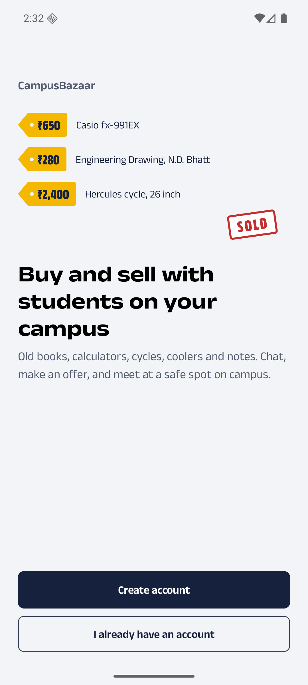
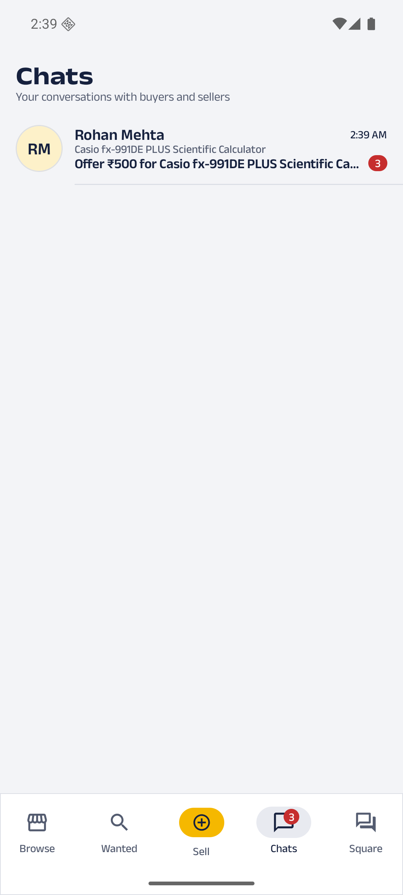
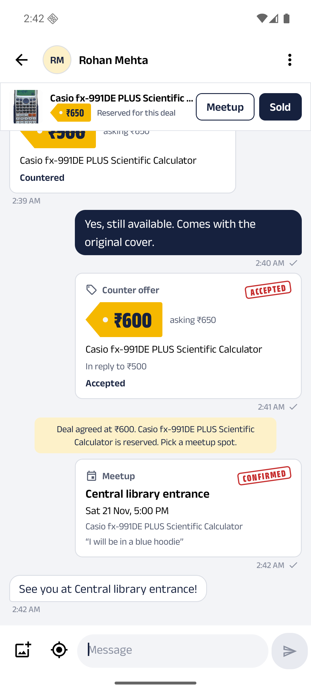
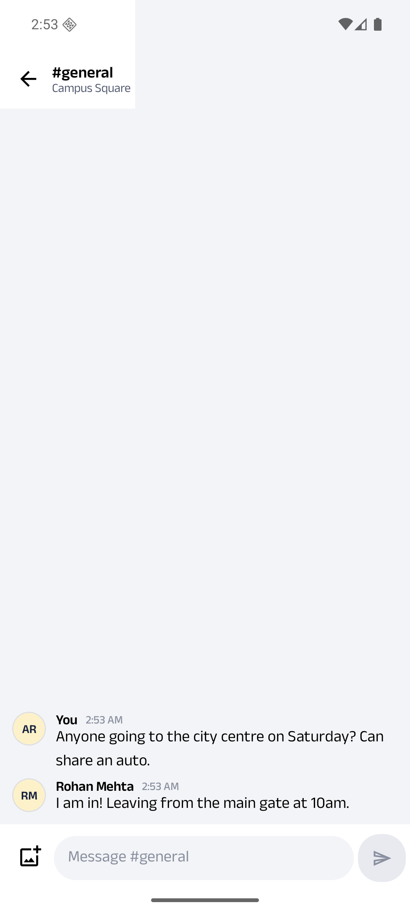
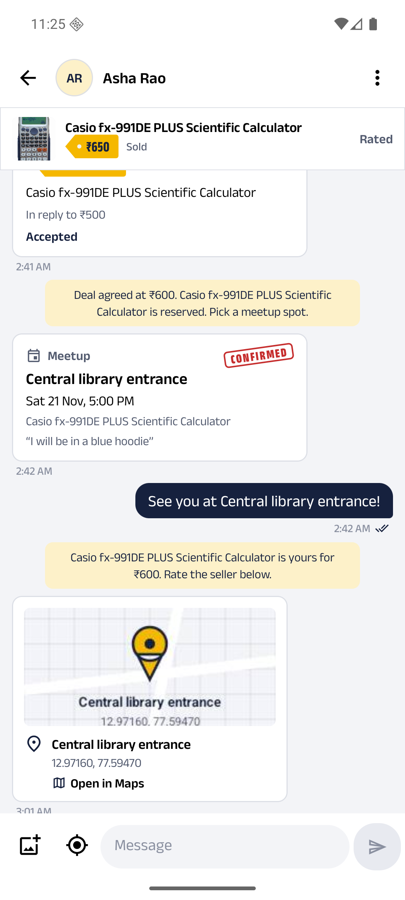

# CampusBazaar

The buy-and-sell marketplace inside your college. Students sell used books, calculators, cycles,
coolers, hostel gear and notes to other students on the same campus, then chat, negotiate with
offer cards and meet at a safe spot on campus. Prices in ₹.

- **Android app (signed APK):** https://n2leoh3capfibtkl.public.blob.vercel-storage.com/cbz/releases/campusbazaar-v1.0.0.apk
  (also attached to the GitHub Release `v1.0.0`)
- **Backend (Vercel production):** https://campusbazaar-api.vercel.app

Built for the Nexconn Build Challenge 2026: a native Kotlin + Jetpack Compose app on the Nexconn
Android Chat SDK, with a Next.js API on Vercel, Neon Postgres, Vercel Blob and Gemini vision.

## What it does

1. **Sign up and pick your campus.** Campuses are real rows anyone can add (name + city, deduped:
   "I.I.T. Delhi" and "IIT delhi" are the same campus). Adding a campus provisions its Nexconn
   community channel; joining one adds you to it.
2. **Sell in under a minute.** Take photos with the in-app camera (CameraX) or pick up to 5 from
   the photo picker. Photos upload through the server to Blob, and **Gemini vision drafts the
   title, category, condition, description and a fair used price range in ₹**. The seller edits
   anything, sets price, negotiable yes/no and a meetup spot. Low-confidence drafts stay
   suggestions. Edit, reserve, mark sold or delete your listings.
3. **Browse and find.** Campus feed (newest first), category chips, search, filters (price range,
   condition, sort), listing detail with photo pager and seller card (rating, response rate, items
   sold), saved items, and **Wanted** posts that sellers answer with one of their listings.
4. **Chat and negotiate.** "Chat with seller" opens the Nexconn direct channel between the two
   students, anchored by a **listing card**. **Offer cards** (Accept / Counter / Decline) keep
   their live state in Nexconn **message metadata**, mirrored from the server's deal records, so
   both phones update instantly. Accepting reserves the item for that buyer. A **meetup card**
   proposes a campus spot and time (optionally with a **location message**). The seller marks it
   sold and both sides rate each other. Text, photos, read state, unread badges, conversation list.
5. **Campus Square.** Each campus has a Nexconn community channel with #general, #books,
   #electronics, #rides-and-trips and #lost-and-found.
6. **Safety.** Block (Nexconn blocklist + server record that hides listings both ways), report a
   user or listing, hide a listing, and safe-meetup tips.
7. **Activity inbox.** Reservations, sales, ratings and wanted-post responses arrive as Nexconn
   **system-channel** notices from the CampusBazaar bot, with an in-app banner in real time.

## Screenshots

Real screenshots from the release APK on an Android 16 emulator, against production. The buyer
in these runs is a second real account driven through the backend and the Nexconn Platform Chat
API (`server/scripts/second-student.mjs`).

| | | |
|---|---|---|
|  |  |  |
|  |  |  |
|  |  |  |

More in [docs/screenshots](docs/screenshots).

## How this uses Nexconn

| Nexconn feature | Where |
|---|---|
| Android Chat SDK init, Singapore data center (`AreaCode.SG`), custom message registration | `android/.../chat/NexconnManager.kt` `ensureInitialized` |
| Connect once per lifecycle, connection status handler, reconnect UI, **token refresh** on 31004/31020 and `TOKEN_INCORRECT` | `NexconnManager.connect`, `data/session/SessionManager.kt`, server `POST /api/me/nexconn-token` |
| **Direct channels** (buyer–seller chat) | `ui/chats/ChatViewModel.kt` (`DirectChannel`) |
| **Custom message types**: `cbz:listing`, `cbz:offer`, `cbz:meetup`, `cbz:deal`, `cbz:notice` | `chat/messages/CustomMessages.kt` |
| **Message metadata** for offer and meetup state (sent with initial metadata, updated with `setMetadata`, `onMessageMetadataUpdated`) | `ChatViewModel.mirror`, `NexconnManager.setMetadata`; server-side equivalent in `server/scripts/second-student.mjs` |
| **Image messages** (SDK media upload with progress) | `ChatViewModel.sendImage`, `SquareScreens.kt` |
| **Location messages** (`RC:LBSMsg` with rendered preview) | `ChatViewModel.shareLocation`, `util/LocationThumb.kt`, relay `server/src/app/api/chats/location` |
| **Read receipts** (`needReceipt`, `sendReadReceiptResponse`, `getMessageReadReceiptInfo`, `onMessageReceiptResponse`) | `ChatViewModel.markRead` / `refreshReceipts` |
| **Typing indicators** (`sendTypingStatus`, `onTypingStatusChanged`) | `ChatViewModel.onTyping` / `startTyping` |
| **Unread counts** and `clearUnreadCount` | `ConversationsScreen.kt`, `AppRoot.kt` `BadgesViewModel`, `SquareViewModel` |
| **Conversation list** (`createChannelsQuery`) | `ConversationsViewModel` |
| **History pagination** (`createMessagesQuery`, `loadNextPage`) | `ChatViewModel.loadHistory`, `SubchannelViewModel`, `ActivityViewModel` |
| **Community channels + subchannels**: create, create subchannels, join, leave, membership check, list (Platform Chat API); send/receive and subchannel unread (SDK) | `server/src/lib/nexconn.ts`, `server/src/lib/campus-membership.ts`, `server/src/app/api/campus/square`, `android/.../ui/square/SquareScreens.kt` |
| **System channel** notices from a bot account (Platform Chat API) shown as the Activity inbox | `nexconn.ts` `sendSystemNotice`, `ui/profile/ProfileScreens.kt` `ActivityViewModel` |
| **User blocking** (`addToBlocklist` / `removeFromBlocklist`) | `NexconnManager.block`, chat/profile/listing menus |
| **Server-side direct messages** and **message metadata** (Platform Chat API) | `nexconn.ts` `sendDirectMessage`, `setDirectMessageMetadata`; `scripts/second-student.mjs` |
| User profile sync to Nexconn (`/v4/user/update`) | `server/src/app/api/me/route.ts` |

The App Secret lives only in server env vars. The APK contains no secrets: it fetches the App Key
from the session response / `GET /api/config`.

## Tech stack

- **Android:** Kotlin 2.2, Jetpack Compose (Material 3), Navigation (type-safe routes), manual
  constructor DI (`AppContainer`), Retrofit + kotlinx.serialization, OkHttp with offline cache
  fallback, Coil 3, CameraX, DataStore + Android Keystore (AES-GCM) for the session, Nexconn Chat
  SDK 26.4.2. minSdk 26, target/compile 36.
- **Server:** Next.js 16 route handlers (TypeScript strict), Drizzle ORM on Neon Postgres, zod,
  bcrypt + JWT, Postgres-backed rate limiting, Vercel Blob, `@google/genai` (Gemini
  `gemini-3.5-flash-lite` with fallback `gemini-3.1-flash-lite`, structured JSON output).
- **Design:** four colours (paper `#F3F4F7`, ink `#16213E`, marigold price-tag `#F5B800`, stamp
  red `#C62E2E`), no gradients; Anek Latin variable font (Ek Type) bundled, with its width axis
  used for price tags; Material icons.

## Run it

### Server

```
cd server
npm install
vercel env pull .env.local --yes      # Neon, Blob, Nexconn, Gemini, JWT_SECRET, NEXCONN_ID_PREFIX
npm run db:migrate
npm run dev                           # http://localhost:3107
npm test                              # 14 unit tests
node scripts/e2e.mjs https://campusbazaar-api.vercel.app path/to/item-photo.jpg   # 48 live checks
vercel deploy --prod
```

### Android

```
cd android
./gradlew testDebugUnitTest assembleDebug     # 17 unit tests
./gradlew assembleRelease                     # needs android/keystore.properties
./gradlew --stop
```

The API URL defaults to production; override with `-Pcbz.apiBaseUrl=http://10.0.2.2:3107`.

**Release signing.** `android/campusbazaar-release.jks` and `android/keystore.properties` are
gitignored. To regenerate (this changes the signing identity, so existing installs must be
uninstalled first):

```
keytool -genkeypair -keystore android/campusbazaar-release.jks -alias campusbazaar \
  -keyalg RSA -keysize 2048 -validity 10000
# then create android/keystore.properties:
# storeFile=campusbazaar-release.jks
# storePassword=...
# keyAlias=campusbazaar
# keyPassword=...
```

### Two-sided demo with one phone

`server/scripts/second-student.mjs` drives a second real student through the backend and the
Nexconn Platform Chat API (sign up, join campus, find, chat, offer, accept/counter, confirm
meetup, rate, post in Campus Square). It needs `server/.env.local` (the Nexconn secret never
leaves the server machine).

## Known limitations

- **No push notifications.** FCM would require configuring the shared Nexconn console, which was
  not allowed. The app shows real-time in-app banners and posts local notifications while its
  process is alive, plus the Activity inbox.
- **Location messages are relayed.** On this App Key the Android SDK rejects client-side
  `RC:LBSMsg` sends with an undocumented error 31610. The app tries the SDK first, then asks the
  server to send the same built-in location message through the Platform Chat API (echoed back to
  the sender). Text, image and custom messages go through the SDK directly.
- One direct channel per pair of students (that is how Nexconn direct channels work). Each
  listing's negotiation is anchored by its listing card and a per-listing thread on the server;
  when two students negotiate several items, the chat header lets you switch the active item.
- Typing indicators and read receipts are implemented with the SDK; the emulator run used one
  device plus a server-driven second student, so typing was not observed end to end.
- The in-app camera works; the emulator's virtual camera preview did not render in screenshots, so
  the demo listing used the photo picker.
