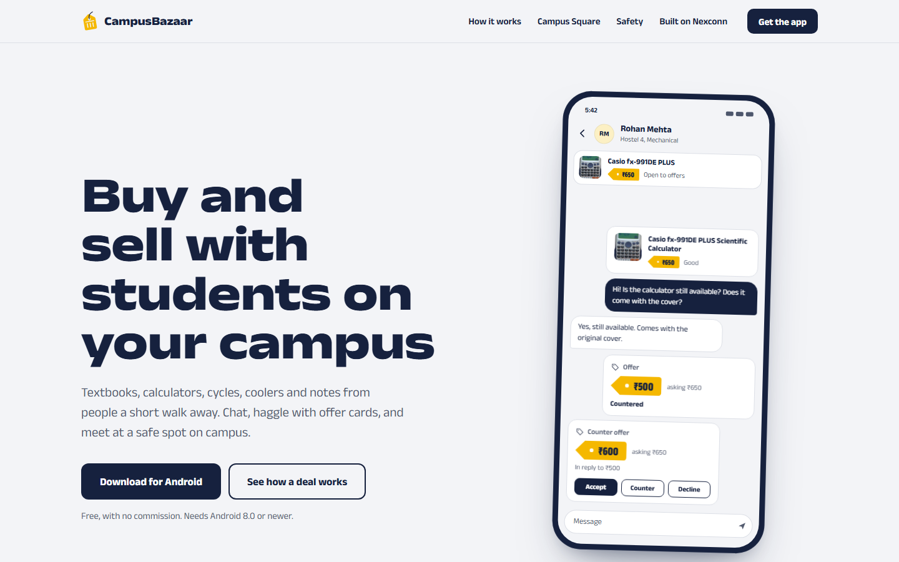
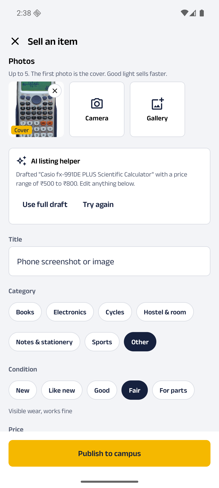
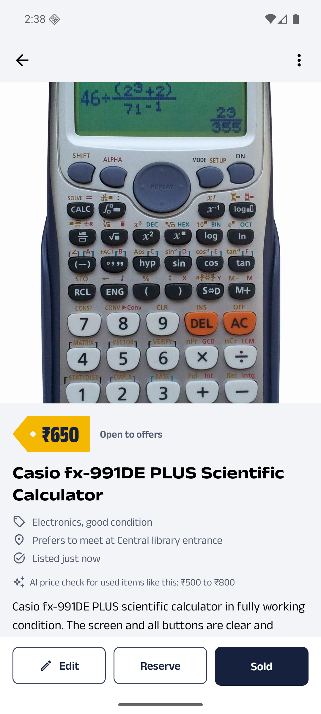
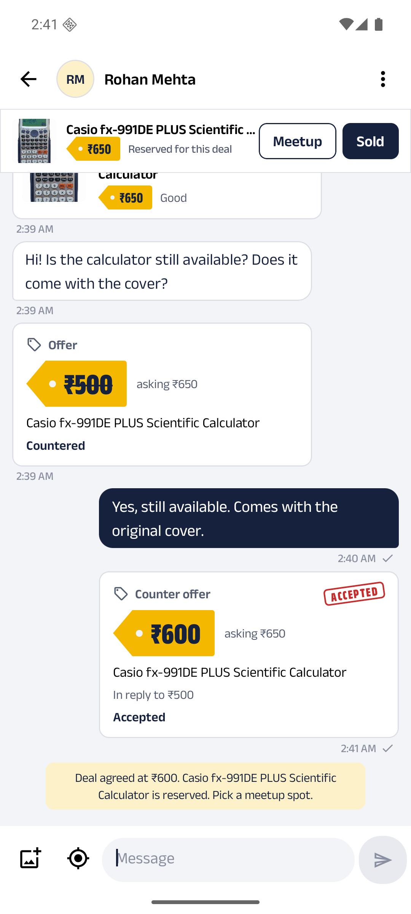
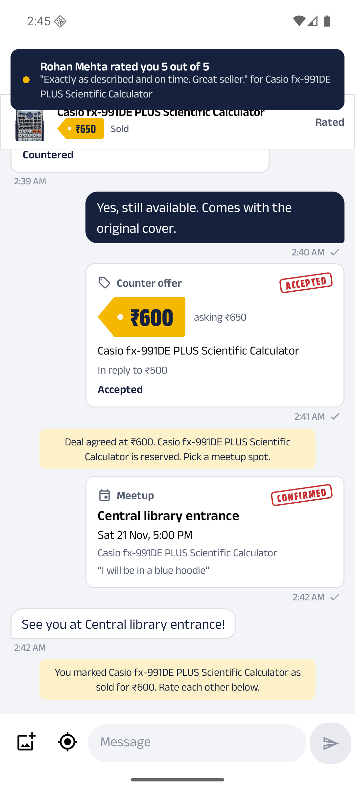

<p align="center">
  
</p>

<h1 align="center">CampusBazaar</h1>

<p align="center">
  The buy-and-sell marketplace inside your college, with real-time chat on Nexconn.
</p>

<p align="center">
  <a href="https://campusbazaar-api.vercel.app">Website</a> ·
  <a href="https://campusbazaar-api.vercel.app/download">Download for Android (v1.1.1)</a> ·
  <a href="https://campusbazaar-api.vercel.app/safety">Safe meetup guide</a>
</p>

Students sell used books, calculators, cycles, coolers, hostel gear and notes to other students on the
same campus. They chat, haggle with offer cards that update live on both phones, and meet at a safe
spot on campus. Prices are in ₹ and everything is scoped to the student's campus.

Built for the Nexconn Build Challenge 2026: a native Kotlin + Jetpack Compose app on the **Nexconn
Android Chat SDK**, and a Next.js server (API and website) that uses the **Nexconn Platform Chat API**,
on Vercel with Neon Postgres, Vercel Blob and Gemini vision.



- **Android app:** [signed APK v1.1.1](https://campusbazaar-api.vercel.app/download/apk) (Android 8.0+),
  install steps on the [download page](https://campusbazaar-api.vercel.app/download)
- **Website and API (Vercel production):** https://campusbazaar-api.vercel.app

## What it does

1. **Sign up and pick your campus.** Campuses are real rows anyone can add (name + city, deduped:
   "I.I.T. Delhi" and "IIT delhi" are the same campus). Adding a campus provisions its Nexconn
   community channel; joining one adds you to it.
2. **Sell in under a minute.** Take photos with the in-app camera (CameraX) or pick up to 5 from the
   photo picker. Photos upload through the server to Blob, and **Gemini vision drafts the title,
   category, condition, description and a fair used price range in ₹**. The seller edits anything,
   sets price, negotiable yes/no and a meetup spot. Edit, reserve, mark sold or delete listings.
3. **Browse and find.** Campus feed (newest first), category chips, search, filters (price range,
   condition, sort), listing detail with photo pager and seller card (rating, response rate, items
   sold), saved items, and **Wanted** posts that sellers answer with one of their listings.
4. **Chat and negotiate.** "Chat with seller" opens the Nexconn direct channel between the two
   students, anchored by a **listing card**. **Offer cards** (Accept / Counter / Decline) keep their
   live state in Nexconn **message metadata**, mirrored from the server's deal records, so both phones
   update instantly. Accepting reserves the item for that buyer. A **meetup card** proposes a campus
   spot and time (optionally with a **location message**). The seller marks it sold and both sides
   rate each other. Text, photos, read receipts, unread badges, conversation list.
5. **Campus Square.** Each campus has a Nexconn community channel with #general, #books,
   #electronics, #rides-and-trips and #lost-and-found.
6. **Safety.** Block (Nexconn blocklist + a server record that hides listings both ways and stops
   every deal action), report a student or listing, hide a listing, and safe-meetup tips.
7. **Activity inbox.** Reservations, sales, ratings and wanted-post responses arrive as Nexconn
   **system-channel** notices from the CampusBazaar bot, with an in-app banner in real time.
8. **Account deletion,** in the app (Profile → Delete account) or on the
   [website](https://campusbazaar-api.vercel.app/delete-account). It anonymises the account, takes
   down listings and wanted posts, and revokes the student's Nexconn tokens.

## Screenshots

Real screenshots from the release APK on an Android 16 emulator, against production. The second
student in these runs is a real account driven through the backend and the Nexconn Platform Chat API
(`server/scripts/second-student.mjs`).

| | | |
|---|---|---|
|  |  |  |
|  |  |  |
|  |  |  |

More in [docs/screenshots](docs/screenshots).

## How Nexconn is integrated

```
Android app (Compose, Retrofit, Nexconn Chat SDK 26.4.2)
   |  HTTPS JSON (Bearer JWT)                 |  Nexconn SDK socket (Singapore data center)
   v                                          v
Next.js on Vercel (API + website)  ------->  Nexconn Platform Chat API (api.sg-light-api.com)
   |  Drizzle (neon-http)   |  @vercel/blob     tokens, community channels, system notices,
   v                        v                   direct messages, message metadata, blocklist
Neon Postgres           Vercel Blob (photos, APK)
   |
   +--> Gemini (vision listing drafts, server-side key only)
```

The split is deliberate. **The server owns identity and provisioning**: it registers each student
with Nexconn and issues their access token, creates and joins community channels, sends bot notices,
and mirrors blocks. **The app owns live messaging** through the SDK: direct chats, custom cards,
metadata updates, receipts, typing and unread counts. The server is the source of truth for deal
state (offers, meetups, reservations); Nexconn message metadata mirrors it so both phones update
without polling.

| Nexconn feature | What students see | Where |
|---|---|---|
| Android Chat SDK init, Singapore data center (`AreaCode.SG`), custom message registration | — | `android/.../chat/NexconnManager.kt` `ensureInitialized` |
| Access tokens issued by the server (`/v4/auth/access-token/issue`), one connect per lifecycle, refresh on 31004/31020 and `TOKEN_INCORRECT`, single-flight refresh | Stays signed in to chat | `NexconnManager.connect`, `data/session/SessionManager.kt`, `POST /api/me/nexconn-token` |
| **Direct channels** | "Chat with seller" | `ui/chats/ChatViewModel.kt` (`DirectChannel`) |
| **Custom message types**: `cbz:listing`, `cbz:offer`, `cbz:meetup`, `cbz:deal`, `cbz:notice` | Listing, offer, meetup and deal cards | `chat/messages/CustomMessages.kt` |
| **Message metadata** (sent with initial metadata, updated with `setMetadata`, `onMessageMetadataUpdated`; server-side `/v4/channel-type/message/metadata/set`) | Offer and meetup cards change state live on both phones | `ChatViewModel.mirror`, `NexconnManager.setMetadata`, `scripts/second-student.mjs` |
| **Image messages** (SDK media upload with progress) | Photos in chat and Campus Square | `ChatViewModel.sendImage`, `SquareScreens.kt` |
| **Location messages** (`RC:LBSMsg` with rendered preview) | Map pin on a meetup | `ChatViewModel.shareLocation`, `util/LocationThumb.kt`, relay `api/chats/location` |
| **Read receipts** (`needReceipt`, `sendReadReceiptResponse`, `getMessageReadReceiptInfo`) | Seen ticks, only while the chat is on screen | `ChatViewModel.markRead` / `refreshReceipts` |
| **Typing indicators** (`sendTypingStatus`, `onTypingStatusChanged`) | "typing…" | `ChatViewModel.onTyping` |
| **Unread counts**, `clearUnreadCount`, **conversation list** (`createChannelsQuery`) | Chats tab and badges | `ConversationsScreen.kt`, `AppRoot.kt` `BadgesViewModel` |
| **History pagination** (`createMessagesQuery`, `loadNextPage`) | Scroll back through a chat | `ChatViewModel.loadHistory`, `SubchannelViewModel`, `ActivityViewModel` |
| **Community channels + subchannels** (create, subchannel create/list, join, leave, member check via the Platform API; send/receive via the SDK) | Campus Square | `server/src/lib/nexconn.ts`, `server/src/lib/campus-membership.ts`, `api/campus/square`, `ui/square/SquareScreens.kt` |
| **System channel** notices from a bot (`/v4/system-channel/message/send`) | Activity inbox and banners | `nexconn.ts` `sendSystemNotice`, `ProfileScreens.kt` `ActivityViewModel` |
| **User blocklist** (SDK `addToBlocklist` plus server `/v4/user/blocklist/add` and `/remove`) | Block a student | `NexconnManager.block`, `api/blocks` |
| **Server-side direct messages** (`/v4/direct-channel/message/send`) | Location relay, demo buyer | `nexconn.ts` `sendDirectMessage` |
| User profile sync (`/v4/user/update`) and **token expiry** (`/v4/auth/access-token/expire`) | Name and photo in chat; chat access revoked on account deletion | `api/me`, `server/src/lib/account.ts` |

The App Secret lives only in server env vars. The APK contains no secrets: it gets the App Key from
the session response and `GET /api/config`.

### What we learned about Nexconn

- **Joining a community channel that doesn't exist succeeds.** `community-channel/join` returns
  `code 0` for a channel that was never created, and `member/exist` then reports `isMember: true`.
  After an App Key change nothing fails loudly, so Campus Square provisioning is self-healing: a
  channel with none of its subchannels is treated as unprovisioned and created (create calls are
  idempotent). Campus channel ids are an HMAC of the normalised campus name, so retries and races
  converge on one channel.
- **A positive connect `timeout` turns off reconnection.** With `timeout > 0` the SDK gives up after
  that time and reports `TIMEOUT`. The app uses `timeout = 0` (the SDK's own strategy) and reconnects
  itself when the network returns after a failure.
- **Access tokens only work with the App Key that issued them** (31004). The app checks the server's
  current key before connecting and re-initialises the SDK if it changed.
- Business error codes are four or five digits; only 429, 500 and 504 are transient. The server
  client fails fast on everything else and never retries message sends on a timeout, so a notice
  can't arrive twice.
- The Android SDK rejects client-side location messages on this App Key with the undocumented error
  31610; the app sends the same `RC:LBSMsg` through the Platform API instead.
- Typing status only works in direct channels.
- A received community-channel message carries a `CommunitySubChannelIdentifier` only when its
  subchannel id is set; otherwise the SDK reports just the community. An open Campus Square
  subchannel refreshes its newest page in that case, and checks every few seconds while on screen.

## The website

The Next.js server also serves the public site, in the same visual language as the app: four
colours (paper `#F3F4F7`, ink `#16213E`, marigold price-tag `#F5B800`, stamp red `#C62E2E`) and one
typeface, Anek Latin, using its width axis (expanded headlines, condensed price tags).

- `/`: the hero replays a real negotiation in the app's own chat UI (offer, counter, ACCEPTED stamp,
  reserved, confirmed meetup); a sticky phone walks through the four deal steps with real screenshots;
  Campus Square; safety; a Built on Nexconn table; FAQ; QR download. Motion pauses off screen and
  respects `prefers-reduced-motion`.
- `/download` with install steps and a QR code; `/download/apk` is a stable link that redirects to the
  current signed APK.
- `/safety` (safe meetup guide, including UPI scams and the 1930 cyber fraud helpline), `/privacy`,
  `/terms`, `/delete-account`, and a 404 page.
- Favicon, Apple touch icon, PWA manifest and icons, Open Graph and Twitter cards, `robots.txt`,
  `sitemap.xml`, and security headers on every route.

**Logo.** An upright marigold price tag on its string that doubles as a college portico: pediment,
round window, lintel and columns. One definition in `server/scripts/build-brand.mjs` generates every
icon; the Android launcher and in-app mark use the same geometry.

## Production readiness

- **Security:** secrets server-side only; bcrypt passwords; JWT sessions that stop working the moment
  an account is deleted; Postgres-backed rate limits (sign-in counts only failed attempts, per
  network and per account); zod validation on every input; listing photos and avatars must be the
  student's own uploads (no third-party hosts, no `file:`/`javascript:` URIs); `X-Frame-Options`,
  `nosniff`, `Referrer-Policy` and `Permissions-Policy` headers.
- **Deal integrity:** accepting an offer reserves the item and accepts the offer in one SQL statement,
  so concurrent accepts can't both win; blocks are enforced on every offer, counter, accept and
  meetup action; sold listings can't be deleted (they back ratings and items-sold counts).
- **Privacy:** no analytics or ad SDKs; email never shown to other students; account deletion in the
  app and on the web, which anonymises the account while keeping counterparties' deal history.
- **Tests:** 17 server unit tests, 17 Android unit tests, and a 56-check end-to-end suite that runs
  against production (Neon, Nexconn, Blob and a real Gemini vision draft) and cleans up after itself.
  Each release is also driven end to end on two emulators side by side against production (seller
  and buyer), which is how the demo video was recorded.

## Tech stack

- **Android:** Kotlin 2.2, Jetpack Compose (Material 3), Navigation (type-safe routes), manual
  constructor DI (`AppContainer`), Retrofit + kotlinx.serialization, OkHttp with offline cache
  fallback, Coil 3, CameraX, DataStore + Android Keystore (AES-GCM) for the session, Nexconn Chat SDK
  26.4.2. minSdk 26, target/compile 36.
- **Server and website:** Next.js 16 (App Router, TypeScript strict), Drizzle ORM on Neon Postgres,
  zod, bcrypt + JWT, Vercel Blob, `@google/genai` (Gemini `gemini-3.5-flash-lite` with fallback
  `gemini-3.1-flash-lite`, structured JSON output), Anek Latin via `next/font`, `qrcode`.

## Run it

### Server and website

```
cd server
npm install
vercel env pull .env.local --yes      # Neon, Blob, Nexconn, Gemini, JWT_SECRET, NEXCONN_ID_PREFIX
npm run db:migrate
npm run dev                           # http://localhost:3107
npm test                              # 17 unit tests
node scripts/e2e.mjs https://campusbazaar-api.vercel.app path/to/item-photo.jpg   # 56 live checks
vercel deploy --prod
```

Brand assets (favicon, icons, web screenshots) are generated with `node scripts/build-brand.mjs`.

### Android

```
cd android
./gradlew testDebugUnitTest assembleDebug     # 17 unit tests
./gradlew assembleRelease                     # needs android/keystore.properties
./gradlew --stop
```

The API URL defaults to production; override with `-Pcbz.apiBaseUrl=http://10.0.2.2:3107`.

**Release signing.** `android/campusbazaar-release.jks` and `android/keystore.properties` are
gitignored. To regenerate (this changes the signing identity, so existing installs must be
uninstalled first):

```
keytool -genkeypair -keystore android/campusbazaar-release.jks -alias campusbazaar \
  -keyalg RSA -keysize 2048 -validity 10000
# then create android/keystore.properties:
# storeFile=campusbazaar-release.jks
# storePassword=...
# keyAlias=campusbazaar
# keyPassword=...
```

**Publishing a release.** Bump `versionCode`/`versionName`, build the release APK, upload it to Blob
as `cbz/releases/campusbazaar-v<version>.apk`, set `APK_DOWNLOAD_URL` on Vercel and redeploy. The
website reads the version from that URL.

### Rotating the Nexconn App Key

1. Set `NEXCONN_APP_KEY`, `NEXCONN_APP_SECRET` and `NEXCONN_API_BASE` in Vercel (Production and
   Development) and in `server/.env.local`, then `vercel deploy --prod`.
2. Nothing else is needed. Users, the notice bot and community channels are registered in the new
   app on first use (Campus Square self-heals), and the app picks up the new key from
   `/api/config`, fetches a matching token and re-initialises the SDK.
3. Chat history from the old app isn't carried over: Nexconn messages belong to the app that sent
   them. Deal state lives on the server and is unaffected.

### Two-sided demo with one phone

`server/scripts/second-student.mjs` drives a second real student through the backend and the Nexconn
Platform Chat API (sign up, join campus, find, chat, offer, accept/counter, confirm meetup, rate, post
in Campus Square). It needs `server/.env.local` (the Nexconn secret never leaves the server machine).

## Known limitations

- **No push notifications.** FCM would require configuring the shared Nexconn console, which was not
  allowed. The app shows real-time in-app banners and posts local notifications while its process is
  alive, plus the Activity inbox.
- **Location messages are relayed** through the server (see error 31610 above). Text, image and
  custom messages go through the SDK directly.
- One direct channel per pair of students (that is how Nexconn direct channels work). Each listing's
  negotiation is anchored by its listing card and a per-listing thread on the server; when two
  students negotiate several items, the chat header lets you switch the active item.
- Android only; there is no iOS app yet. The APK is distributed directly rather than through the Play
  Store.
